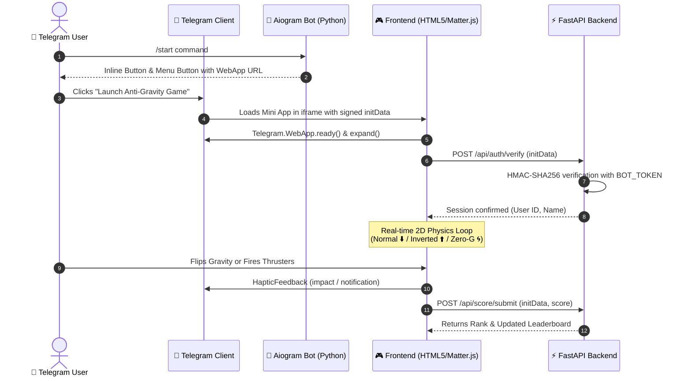

# 🌌 Anti-Gravity: Quantum Core (Telegram Mini App)

A web-based casual game with dynamic physics and **anti-gravity mechanics** engineered specifically for the **Telegram Mini Apps (TMA)** ecosystem.

---

## 🏛 Architecture Overview



---

## 📁 Project Structure

```
main id/
├── bot/
│   └── bot.py           # Aiogram 3 bot router (/start, WebApp inline buttons)
├── server/
│   ├── app.py           # FastAPI backend (lifespan bot runner, score API, static files)
│   └── auth.py          # Telegram WebApp initData HMAC-SHA256 cryptographic validator
├── static/
│   ├── css/
│   │   └── style.css    # Cyberpunk space aesthetics, glassmorphism HUD, responsive modals
│   ├── js/
│   │   ├── game.js      # Matter.js physics engine, zero-g states, audio synth, particles
│   │   └── tg.js        # Telegram WebApp SDK bridge, haptics, auth & telemetry
│   └── index.html       # HTML5 game container, HUD, and modal interfaces
├── requirements.txt     # Python dependencies
├── .env.example         # Environment template
└── README.md            # Complete architectural and deployment manual
```

---

## ⚙️ How It Works

### 1. Anti-Gravity Mechanics
- **Normal Gravity (1.0G ⬇️):** Standard downward earth-like pull.
- **Inverted Gravity (-1.0G ⬆️):** Downward forces reversed. Objects and player core fall toward the ceiling.
- **Zero-G Float (0.0G 🌀):** Complete weightlessness. The player core drifts based on conservation of momentum and inertia.
- **Micro-Thruster Pulse:** Tapping anywhere on screen or clicking fires a directional ion burst towards the tap point, allowing precision maneuvers in zero gravity.

### 2. Cryptographic Security (`initData` Verification)
Telegram Mini Apps pass an HMAC-SHA256 signed query string (`Telegram.WebApp.initData`). The backend validates that:
1. `secret_key = HMAC_SHA256("WebAppData", BOT_TOKEN)`
2. `hash = HMAC_SHA256(secret_key, sorted_data_string)`
3. `auth_date` is checked to prevent replay attacks.
This guarantees high scores and sessions cannot be spoofed.

---

## 🚀 Step-by-Step Setup Guide

### Step 1: Clone & Install Dependencies

```bash
# Create and activate virtual environment
python -m venv venv
# On Windows:
.\venv\Scripts\activate
# On Linux/macOS:
source venv/bin/activate

# Install dependencies
pip install -r requirements.txt
```

---

### Step 2: Create Your Telegram Bot with @BotFather

1. Open Telegram and search for **[@BotFather](https://t.me/BotFather)**.
2. Send `/newbot` and follow the prompts to choose a name and username (e.g., `AntiGravityGameBot`).
3. Copy the **HTTP API Bot Token** provided by BotFather.
4. *(Optional but Recommended)* Configure the Web App Menu button:
   - Send `/setmenubutton` to @BotFather.
   - Choose your bot.
   - Enter the button title: `🎮 Play Game`.
   - Provide your HTTPS WebApp URL (see Step 3).

---

### Step 3: Local Tunneling (Expose HTTPS for Telegram)

Telegram Mini Apps **require an HTTPS connection**. To test locally, use **ngrok** or **Cloudflare Tunnel**:

#### Option A: Using ngrok
```bash
ngrok http 8000
```
Copy the generated HTTPS URL (e.g., `https://a1b2-c3d4.ngrok-free.app`).

#### Option B: Using Cloudflare Tunnel (Free, no account required)
```bash
cloudflared tunnel --url http://localhost:8000
```
Copy the generated `https://...trycloudflare.com` URL.

---

### Step 4: Configure `.env`

Copy `.env.example` to `.env`:

```bash
cp .env.example .env
```

Edit `.env`:
```env
BOT_TOKEN=1234567890:ABCdefGHIjklMNOpqrsTUVwxyz_your_actual_token
WEBAPP_URL=https://your-tunnel-url.ngrok-free.app
HOST=0.0.0.0
PORT=8000
```

---

### Step 5: Run the Server

```bash
python -m server.app
```
or via Uvicorn:
```bash
uvicorn server.app:app --host 0.0.0.0 --port 8000 --reload
```

---

### Step 6: Test Inside Telegram

1. Open your Telegram bot.
2. Send `/start`.
3. Tap **"🌌 Launch Anti-Gravity Game"** or the bottom-left **Play** menu button.
4. The Mini App opens in Telegram with full haptics, username integration, and score submission!

*Note: You can also open `http://localhost:8000` in any web browser to test locally in standalone dev mode.*
